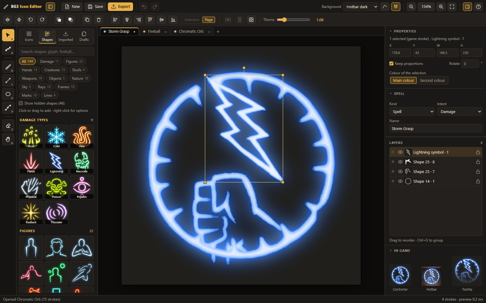
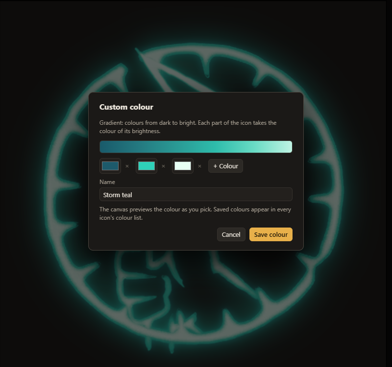
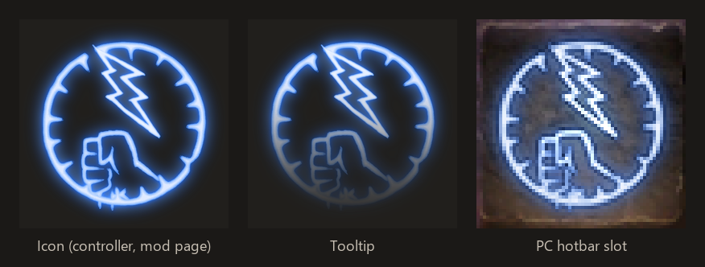
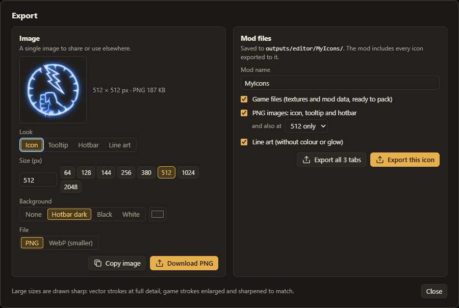

# BG3 Icon Generator

**Make spell and action icons for your Baldur's Gate 3 mods that look like they shipped with the game.**

New spells tend to give themselves away with their icon: a recoloured vanilla one, or art in a different style from
everything around it on the hotbar. This app builds icons out of the game's own strokes, colours them with the game's
own gradients and glow, and exports every file the game needs in one go.

It's free, it runs on your own PC, and you don't need to know Photoshop or how BG3's texture atlases work.

## What you can do with it

**Start from any game icon.** All 1,094 spell, action and illithid power icons are in the library. Open Fireball, take
the flame out, put something else in.

**Build from parts.** 144 pieces cut from the game's icons: the 11 damage-type symbols, hands, figures, creatures,
skulls, weapons, frames, rings, rays and more. Drag them in, scale, rotate, flip, group and line them up.

**Draw your own strokes.** The brush, line, ellipse and pen tools draw in the game's line style, with the same uneven
edges, tapered ends and thorny barbs (spell icons are thornier than action icons, and the brush knows that). Any game
stroke can be made smoother or thornier too.

**Colour it the way the game does.** 31 colour gradients measured from the game's icons. The app picks one from the
spell's damage type and intent, or you choose. You can also make your own colour or gradient:

**See it in game before you build.** Live previews of the controller icon, the tooltip art and the PC hotbar slot. One
drawing gives you all three:

**Export once.** The hotbar atlas DDS and its atlas file, tooltip and controller textures (with their low-res copies)
and the TextureBank entries, laid out as a mod folder. Plus PNG or WebP images up to 2048 px for your Nexus page.

**Bring the icons you already have.** Import a mod's icon files in bulk, even the faded tooltip ones (the faded strokes
get rebuilt). They keep their original names, so you can fix them up and export them straight back into your mod.

Plus tabs for several icons at once, drafts, autosave, full undo, and keyboard shortcuts (press `?` for the list).

## Getting started

Windows 10 or 11. (macOS and Linux start scripts are included but haven't been tested yet.)

1. Download [`BG3-Icon-Generator.zip`](https://github.com/SpasticPengu/BG3-Icon-Generator/releases/latest/download/BG3-Icon-Generator.zip)
   (always the newest version; release notes on the [releases page](https://github.com/SpasticPengu/BG3-Icon-Generator/releases/latest))
   and unzip it anywhere.
2. Double-click **`Start.bat`**. On macOS use `Start.command`, on Linux `./start.sh`.

The first start takes a few minutes and needs the internet once. It sets up its own copy of Python in a `.runtime`
folder next to the app (nothing is installed anywhere else, no admin rights needed) and downloads the game's icons
(about 100 MB). After that the editor opens in your browser. Everything together takes about 420 MB.

You don't need the game files or any other modding tools. To uninstall, delete the folder.

## Putting an icon in your mod

1. Set the icon's **Name in the game** in the Spell panel. That's the name your spell's `Icon` field uses.
2. Click **Export**, pick a mod name and export. Use **Export all tabs** to do several icons at once.
3. Copy the contents of `outputs/editor/<mod name>/mod/` into your mod's folder.

Icons exported to the same mod name share one atlas, so export all of a mod's icons under the same name.

## Updates

When a new version is out, an **Update** button appears in the top bar. It shows what changed and installs it with one
click. Your drafts, colours, imported icons and exports are never touched by an update. You can turn the check off in
the shortcuts sheet (`?`).

## Questions

**Is it really free?** Yes, and it'll stay that way.

**Does it change my game?** No. It only writes files into its own folder. You copy the exported files into your mod.

**Can I use the icons I make in my mods?** Yes, that's what it's for. The game's art stays Larian's: see
[NOTICE.md](NOTICE.md).

**Something broke or looks wrong.** Open an [issue](https://github.com/SpasticPengu/BG3-Icon-Generator/issues) with a
screenshot.

## For developers

Plain Python (numpy, scipy, Pillow) serving a browser editor in `app/` (ES modules, no build step). Rebuilding the game
data needs an unpacked copy of the game and the pipeline in `iconkit/`. `implementation-plan.md` explains how each part
was measured and why it works the way it does, and `research/` holds the scripts behind those numbers. A `v<version>`
tag builds and publishes a release (`.github/workflows/release.yml`). The icon data lives on the separate `data` branch,
one tag per version (`data-v<N>`); clone with `--single-branch` to skip it.

## Licence

The app's code is under the [GNU GPL v3](LICENSE): you can use it, change it and share it, and if you share a
changed version, it has to stay GPL with its source available. The licence covers the code only, not the game's art
(see below).

## Credits

Unofficial fan tool, not made or endorsed by Larian Studios or Wizards of the Coast. Baldur's Gate 3 art belongs to
Larian Studios, Dungeons & Dragons material to Wizards of the Coast, and spell data comes from the SRD 5.1 (CC BY 4.0).
Full notice in [NOTICE.md](NOTICE.md).
